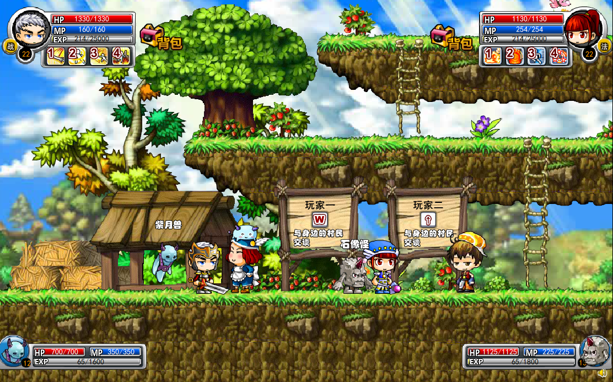
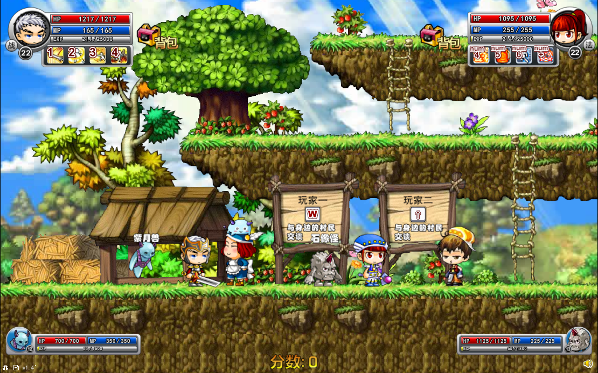
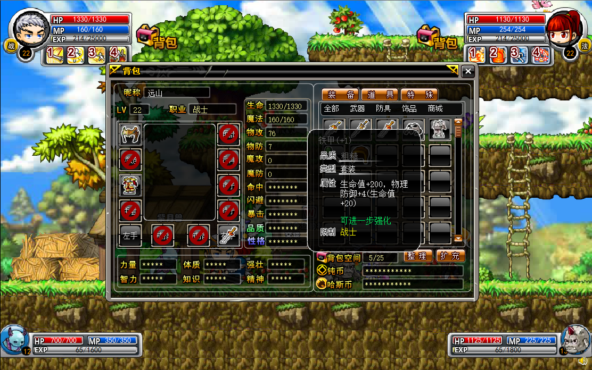
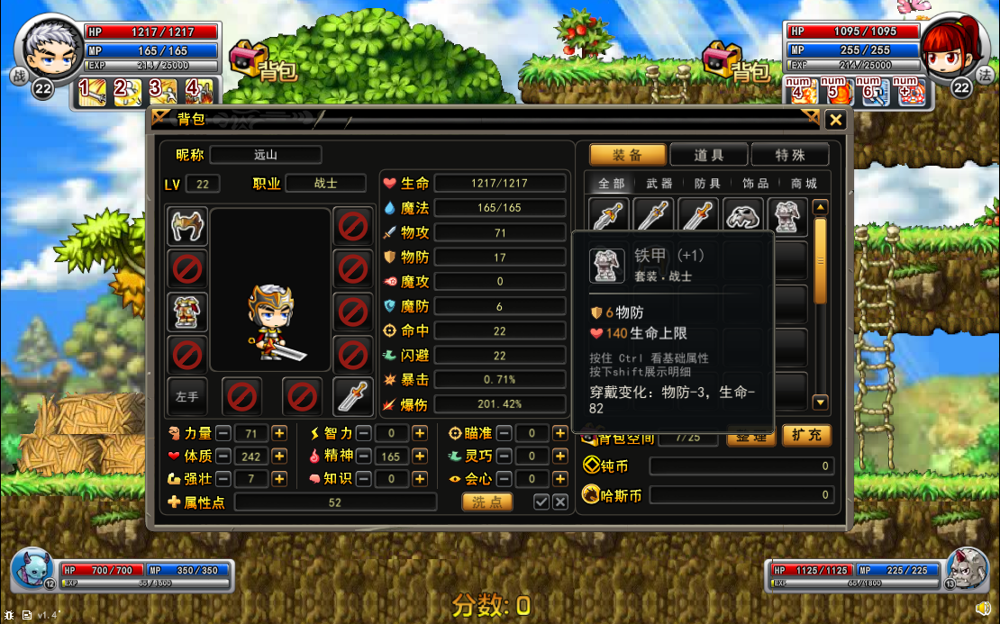
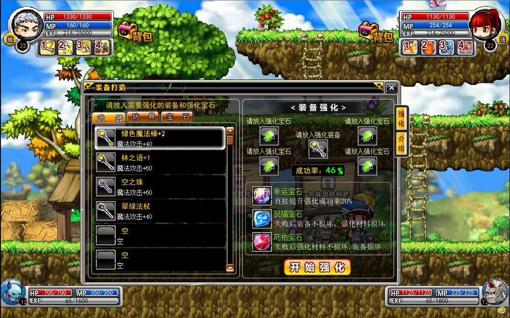
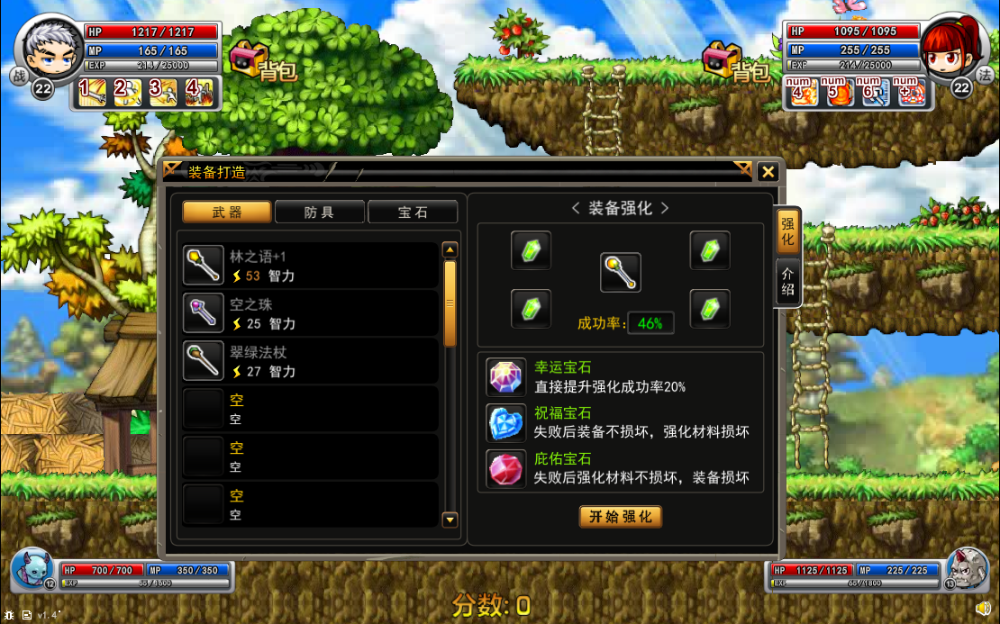
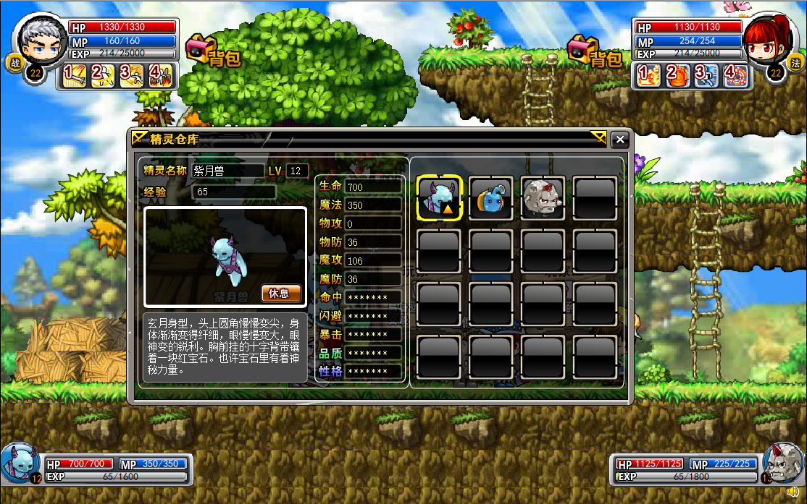
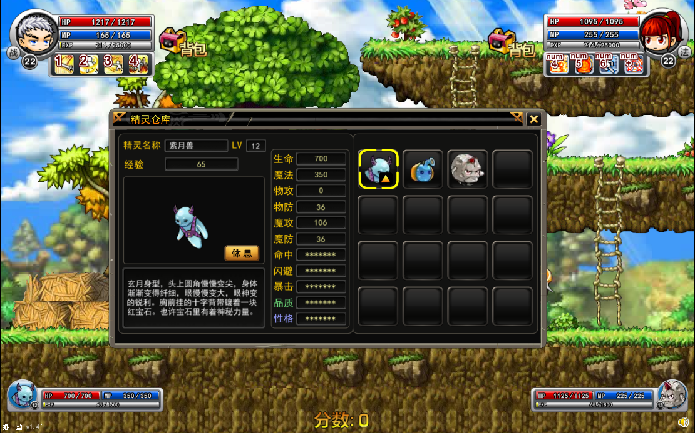

  </a>

# 冒险王·神兵传奇·K版(kitUIN复刻版)

✨原《冒险王·神兵传奇》的复刻版，并进行衍生开发✨

## KingOfAdventures-Releases

《冒险王·神兵传奇》K版（kitUIN复刻版）的 Windows 版本下载、更新公告与问题反馈。

[打开 K 版玩家 Wiki](https://kituin.github.io/KingOfAdventures-Releases/) · 查询装备掉落、关卡路线、职业技能与精灵进化。

根据原《冒险王·神兵传奇》Flash版进行的Unity复刻版本，并在此基础上进行衍生开发，仅供学习交流使用，禁止用于商业。

## 复刻进度

当前进度90%，部分画面与功能仍然缺失，但主体已经可玩

## 后续功能衍生
- [x] [画面改进](#%E7%94%BB%E9%9D%A2%E6%94%B9%E8%BF%9B)，多分辨率支持
- [x] [伤害颜色](#%E4%BC%A4%E5%AE%B3%E9%A2%9C%E8%89%B2)区分
- [x] [远程联机](#%E8%BF%9C%E7%A8%8B%E8%81%94%E6%9C%BA)功能
- [ ] （测试中）九项基础属性(力量，体质，强壮，智力，知识，精神，精准，灵巧，会心)
- [ ] 人物更高等级
- [ ] 装备更高强化等级
- [ ] 装备镶嵌宝石
- [ ] 新装备：饰品
- [ ] 技能树：被动技能
- [ ] 新关卡
- [x] 货币系统
- [ ] （测试中）商城系统
- [ ] 药剂系统

### 画面改进

| 画面 | 源Flash | K版(本作) |
|---|---|---|
| 营地 |  |  |
| 背包 |  |  |
| 装备强化 |  |  |
| 精灵仓库 |  |  |

### 伤害颜色

| 战斗飘字 | 数字颜色 | 示意图 |
|---|---|---|
| 玩家或出战精灵受到物理伤害 | 紫色-玫红渐变 | |
| 玩家或出战精灵受到魔法伤害 | 亮蓝-冰青渐变 ||
| 怪物受到物理伤害 | 橙红-金黄渐变 | |
| 怪物受到魔法伤害 | 亮红-粉白渐变 ||
| 玩家或出战精灵回血 | 翠绿-亮黄绿渐变 | |

### 远程联机

| 联机方式 | 示意图 |
|---|---|
|局域网联机||
|ZeroTier联机||

## 鸣谢
- 《冒险王·神兵传奇》Flash版
- [libzt](https://github.com/zerotier/libzt)
